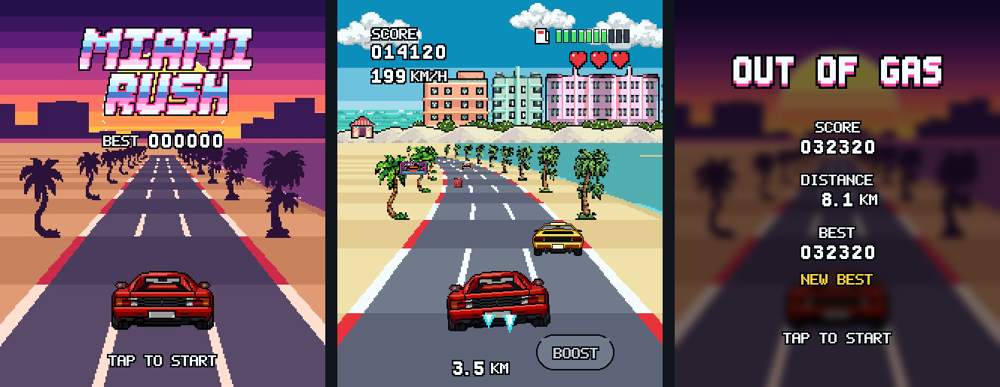

# Miami Rush

An endless arcade racer for the Redmi Watch 6, in 16-bit pixel art: a red 80s sports car on a sunny, palm-lined Miami Beach road.



## The game

The car drives forward on its own. Tap the left or right half of the screen to move one lane; tap BOOST in the bottom-right corner for a short burst of speed.

- **Dodge** road blocks and slower traffic: each hit costs one of your 3 lives. Overtaking a car scores a bonus.
- **Collect** gas cans to keep the tank from running dry, and repair kits to win back a life.
- **Go far:** the road never ends, and it gets faster and busier with every kilometre. The run ends when you're out of lives or out of gas, and the best score is kept.

Every run is a new road, generated as you drive from a random seed, with fairness rules so there's always a way through.

The sprites and backgrounds were made with [PixelLab](https://www.pixellab.ai/), an AI pixel-art generator, and cleaned up by the art scripts, which also draw the road, the HUD, the logo and the title screen; [Art](#art) explains how. `art.jpg` is the concept art the look follows, and [SPEC.md](SPEC.md) is the full game design, including the rendering measurements the design is built on.

## Target platform

- **Watch:** Xiaomi Redmi Watch 6: a 2.07" AMOLED touch screen, 432x514 pixels, 60 Hz.
- **Software:** a Xiaomi Vela JS quick app (`.rpk`), built with Xiaomi's `aiot-toolkit` and sideloaded to the watch.
- **Rendering:** the watch has no working canvas, and every element moved by script costs several milliseconds a frame. So the road is pre-drawn: 42 pictures (7 bends x 6 stripe positions), one swapped in each frame, with at most 4 moving sprites on top. Lane changes and other effects use the watch's native Folme animations. The game targets 25 fps.

## Building the .rpk

You need [Node.js](https://nodejs.org/) (tested with 22) with npm, and OpenSSL for the first release build. The pictures are committed, so Python is only needed to redraw them.

```sh
git clone https://github.com/puzpuzpuz/watch-race-game.git
cd watch-race-game
npm install
npm run build
```

This writes `dist/com.miamirush.game.release.0.1.0.rpk`, which installs on the watch as **Miami Rush**. It's the release build (`aiot release --enable-jsc`): compiled to bytecode and signed with your own key.

- **Signing:** the key pair lives in `sign/` (`private.pem` and `certificate.pem`), which is git-ignored. The first release build creates a self-signed pair with OpenSSL if there is none. Keep it: the watch may refuse an update signed with a different key.
- **Debug build:** `npm run build:debug` writes `dist/com.miamirush.gamedebug.debug.0.1.0.rpk` ("Miami Rush dbg"): plain JavaScript with the toolkit's debug signature. The two packages have different names, so both can be installed at once.
- **Installing:** sideload the `.rpk` with Mi Fitness or AstroBox.

`scripts/build.js` runs the toolkit for each variant. It sets the package name in `src/manifest.json` for the build and restores it afterwards. Set `AIOT` to use an `aiot` other than the one in `node_modules`.

## Development

### Desktop harness

```sh
npm run harness        # http://localhost:8080
```

The harness runs the game's own code at 432x514 in a desktop browser, with plain HTML pictures in place of the watch's page and CSS transitions in place of Folme. It's for playing and tuning without a watch.

- **Taps:** click the left or right half; the bottom-right corner is the boost button.
- **Keys:** arrows change lanes, Space boosts, Enter taps, and P hides and shows the app (pausing the race).
- **URL options:** `?seed=123` replays the same road; `?nofolme` moves the car without Folme.
- **Side panel:** run state, seed, distance, speed, objects on screen and the frame rate. "Round corners" masks the screen like the watch's rounded corners.

### Tests

```sh
npm test
```

| File | What it checks |
| --- | --- |
| `test/track.test.mjs` | The road generator's fairness rules over 40 km for 9 seeds: rows of objects at least 14 segments apart, never all three lanes blocked, room after two-lane blocks, lanes kept clear around rival cars, gas cans at most 360 segments apart, at most 4 objects on screen, and curve shapes. Also that a seed always builds the same road. |
| `test/fuel.test.mjs` | A player who collects every gas can keeps the tank up early on and runs dry between 18 and 40 km, so endless runs end. |
| `test/game.test.mjs` | Game rules: countdown and acceleration, lane changes and tap buffering, boost, scoring, hits, pickups, rival cars, running out of gas, crashing, results, best score and pause. |
| `test/alloc.test.mjs` | 5,000 race frames grow the heap by less than 64 KB, since garbage collection pauses show as stutter on the watch. |
| `test/framepath.test.mjs` | Code that runs every frame allocates nothing: no object or array literals, closures, spread, template strings or string building. |

The heap check runs Node with `--jitless`: V8's optimizing compiler grows and shrinks the heap by about 100 KB on its own, which would hide what the game keeps. V8 can't show the game's garbage either, since its interpreter allocates for numbers that the watch's QuickJS engine doesn't. The source check covers that instead.

### Debug switches

`src/common/js/config.js` holds the build-time switches:

- **`DEBUG`** (on in this version): shows frames per second and the longest frame of the last second during a race. The title screen also gets quarter circles of 60 to 140 px in each corner, to measure the screen's corner radius.
- **`STYLE_MODE`**: moved sprites take turns between two preallocated style objects. Set it to `'fresh'` if sprites stop moving on the watch.
- **`PRELOAD`**: shows every road picture once on the loading screen, so the first race doesn't stutter.

### Art

```sh
npm run assets         # needs Python 3 with Pillow
```

This runs `tools/sprites.py`, which draws every picture except the road, and `tools/road.py`, which draws the 42 road frames. The road frames use the camera constants in `src/common/js/projection.js`, so sprites placed by the game stand on the drawn road. After changing the camera, rerun it.

Pictures are drawn at half resolution and doubled, which gives the 2x2 "fat pixels" of the art style. They're snapped to the palette in the spec and saved as 8-bit palette PNGs. Road objects are saved at 12 sizes, so the game never resizes a picture at run time.

Generator art lives in `art/raw/<name>.png`; a picture without a file there is drawn by the script instead. To replace one, save the new picture under the same name and run `npm run assets`. The script crops the picture and fits it to its frame, adds a dark outline where the picture lacks one, and makes the variant frames itself. Pixel art drawn at the frame's half-resolution size (the sizes below, halved) is used pixel for pixel, on a transparent background or flat magenta (#ff00ff). Larger painted art on magenta is keyed and shrunk to fit. SPEC.md has a prompt for each picture under Sprite production.

| File in `art/raw/` | Becomes | Frames the script adds |
| --- | --- | --- |
| `car.png` | the player's car, 144x80 | leaning left and right: rotated 4° and shifted 3 px |
| `car_crash.png` | the crash frame | |
| `flame.png` | exhaust flames, 48x24 | a mirrored second frame |
| `debris.png` | a smashed road block, 96x64 | a mirrored second frame |
| `rival_taxi.png`, `rival_convertible.png`, `rival_van.png` | rival cars, 128x112 | spun out: rotated 20° |
| `block.png` | the road block, 160x96 | the word CLOSED on its sign |
| `gas.png`, `repair.png` | pickups, 80x80 | a glint frame |
| `billboard.png` | 192x144 | the word MIAMI |
| `lifeguard.png` | 128x144 | |
| `banner.png` | the start gantry, 432x264 | the word START |
| `palm_a.png`, `palm_b.png` | the palms drawn into the road frames | |
| `bg_sky.png`, `bg_city.png` | backgrounds, cropped to cover | a mirrored copy of the skyline, so it repeats seamlessly |
| `logo.png` | 360x120 | |
| `title_bg.png`, `icon.png` | the title screen and the app icon, cropped to cover | the results screen: darkened and blurred |

Words on signs are lettered at a fixed point on the picture (`letter()` calls in `tools/sprites.py`), which needs moving to fit the sign on a new picture.

The pictures in `art/raw/` were made with PixelLab from Claude Code, through PixelLab's [MCP server](https://www.pixellab.ai/mcp):

- **Models:** the fast Pixen and PixFlux models, at 1 generation per picture. Each was generated at its frame's half-resolution size with a transparent background, from SPEC.md's prompts.
- **Rival cars:** the taxi started from the player's car, recoloured yellow (PixFlux image-to-image), which kept the straight rear view. The van started from an earlier, narrower van. With a facing direction set, Pixen drew the cars at an angle.
- **Crash frame:** an edit of the car picture (Pixen edit).
- **Touch-ups:**
  - garbled letters on the taxi's plate and roof sign painted out;
  - a street lamp and a strip of road erased from the billboard, and the road under the start gantry;
  - the sky's dithered bands flattened to three colours.
- **Still drawn by the script:** the logo, the exhaust flames, the title screen and the app icon. The title screen and icon are built from the game's own road, palms and car.

### Code layout

```
src/
  manifest.json, app.ux
  pages/game/game.ux     the one page: layout, styles, and a thin host for the runner
  common/js/
    projection.js        camera constants shared with the art scripts
    rng.js               seeded random numbers (mulberry32)
    track.js             the endless road: curves, objects, fairness rules
    game.js              game states and rules
    scene.js             turns the game state into a description of the frame
    renderer.js          writes that description to the page and starts Folme animations
    runner.js            the frame loop, taps, pausing, best score, keep-screen-on
    assets.js            picture paths, built once at load
    config.js            debug switches
    gen/art.js           picture sizes, written by tools/sprites.py
  common/assets/         the pictures, written by the art scripts
tools/                   sprites.py, road.py, common.py
harness/                 the desktop harness
test/                    Node test suites
art/raw/                 generator art goes here
docs/                    README pictures
SPEC.md                  the game design
art.jpg                  the concept art
```

The game logic is plain JavaScript with no watch-specific imports. That's what lets the harness and the Node tests run the same code as the watch.

## Where this version differs from SPEC.md

- **Camera height 1,050 instead of 1,000.** The spec asks for the camera to be tuned until the road is 400 px wide at the car. That puts the lanes 133 px apart, matching the spec's lane positions.
- **The skyline strip is 1,296 px wide, not 864.** The strip is a tile followed by its mirror image, which repeats every 864 px. To show any 432 px stretch of that loop, the picture needs the tile once more at the end.
- **The start gantry is 432x264 at 3 sizes, not 432x144 at 12.** It has to be taller than the camera to pass over the car rather than slide down the screen. It's only ever seen near the start line, so the smaller sizes would go unused.
- **A few extra pictures:** a blank digit, and the words +1000 (a repair kit at full lives) and DISTANCE (results screen).
- **Hand-made pixel fonts** in `tools/common.py` instead of the Press Start 2P font, so the art scripts need no font files.
- **OUT OF GAS shows as soon as the tank is empty,** while the car coasts to a stop. It disappears if a gas can is collected in time.
- **Spun-out rival cars don't puff smoke.** It would take another moving element, and the frame budget has none to spare.
- **Rival cars are 128x112, not 128x80,** so the van can be as wide as the other cars and taller.
- **Up to 24 colours beyond the palette per picture, not 8.** The generator art has up to 150 colours, and with 8 the taxi's yellow averaged into orange.
- **Generator art is drawn at the frame size, not at 1,024 px.** A pixel-art generator draws at the game's own resolution, so the pixels are used as drawn.

SPEC.md also refers to benchmark apps (`spike/`, `bench/` and others) that measured the watch's rendering. They aren't part of this repository; their results are recorded in the spec.

## License

[Apache License 2.0](LICENSE)
