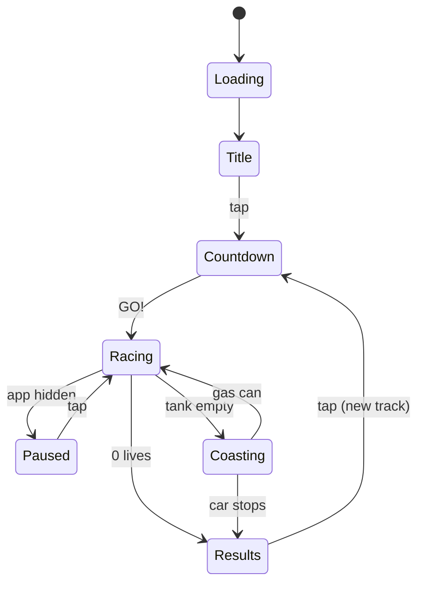

# Miami Rush — Game Spec

2026-10-17

## Overview

Miami Rush is an endless pseudo-3D, three-lane arcade racer for the Redmi Watch 6, drawn from pre-drawn road pictures and a few sprites, at a 25 fps target (20-30 fps acceptable).

- **Platform:** Xiaomi Vela JS quick app (`.rpk`), sideloaded through Mi Fitness or AstroBox.
- **Player:** a red Testarossa-style sports car seen from behind, without real Ferrari badges. It drives forward on its own; the player changes lanes and can fire a short boost.
- **Goal:** drive as far as possible and set the best score. The road never ends, and it gets faster and busier with every kilometre.
- **Hazards:** road blocks and slower rival cars cost a life each. Gas cans and repair kits keep the run going.
- **Run ends:** when lives reach 0, or when the gas tank runs dry.
- **Out of scope for v1:** laps, hills and sound.

## Art direction

The look follows `art.jpg`: sunny-day Miami Beach in 16-bit pixel art, with the ocean and a pastel skyline on the horizon, a palm-lined beach road and bold white HUD type.

- **Pixel style:** sprites use visible 2x2 "fat pixels" at the native 432x514 resolution, hard edges, no anti-aliasing, and transparent PNG backgrounds.
- **80s cues:** pastel art-deco towers (pink, mint, peach), a neon pink-and-cyan billboard, and Testarossa-style side strakes on the car.
- **HUD type:** chunky white pixel letters with a 2 px near-black outline, so they read over sky and road alike.
- **Not carried over:** the Ferrari badge, and the LAP counter, which doesn't fit an endless run.

| Role | Hex | Source |
| --- | --- | --- |
| Sky and ocean highlight | #6bdeec | sampled from art.jpg |
| Shallow water | #50adb0 | sampled |
| Sand | #f0e0aa | sampled |
| Asphalt, light band | #707a8a | sampled |
| Asphalt, dark band | #5e6478 | sampled |
| Lane dashes, HUD text | #f5fcfd | sampled |
| Outline, shadows | #03070d | sampled |
| Car red, shade | #971d2c | sampled |
| Car red, highlight | #e8323c | chosen |
| Rumble strip | #e8323c / #f5fcfd | chosen |
| Palm green | #3a9a3a | chosen |
| Neon accents | #ff3fa4, #39e6ff | chosen |

## Screen layout and HUD

Readouts sit near the top corners, inset from them because the screen's corners are rounded (see Corner clearance below). The bottom strip holds the distance readout and the boost button, and the road and car fill the rest of the 432x514 screen. Positions are in screen pixels, origin top-left.

| Element | Position (px) | Details |
| --- | --- | --- |
| Score | x 44-148, y 36-84 | SCORE label over 6 digits, top-left |
| Speed | x 44-148, y 92-112 | e.g. 185 KM/H, under the score |
| Fuel gauge | x 260-388, y 36-60 | Pump icon (24x24) + 10 segments (8x18, 2 px gaps); 1 segment = 10 units; blinks red at 25 or less |
| Lives | x 308-388, y 68-92 | 3 hearts (24x24, 4 px gaps) under the gauge; outline only once lost |
| Headlines | centred, y about 150 | Countdown, WRECKED, OUT OF GAS, above the horizon |
| Horizon | y = 190 | Background layers above, road below |
| Car | x 144-288, y 360-440 (centre lane) | 144x80; lane centres at x = 83, 216, 349 |
| Distance | x 120-232, y 478-500 | km driven with one decimal, e.g. 12.4 KM; left of centre, clear of the boost button |
| Boost zone | x ≥ 256, y ≥ 436 | Tap zone 176x78 (about 13x6 mm); the visible pill button is 104x48 at x 264-368, y 444-492 |
| Tap zones | split at x = 216 | Whole screen, HUD included, except the boost zone; one tap = one lane |

- **Corner clearance:** the screen's corners are rounded, and Xiaomi doesn't publish the radius. Until it's measured, the layout assumes a cautious 110 px and keeps everything visible 8 px inside the curve. In practice a corner readout starts at least 44 px in from the side and 36 px down. The road, the sky and the tap zones may run into the corners. The same rule applies on the title, pause and results screens.
- **Measuring the radius:** the first game build has a debug overlay with quarter-circle guides of 60 to 140 px in each corner. The guide that follows the screen's edge gives the real radius, and the corner positions above are recomputed from it.
- **Tap target size:** at 324 PPI, 1 mm is about 13 px. The boost zone (176x78 px, about 13x6 mm) is the smallest target.
- **Boost button:** bright when ready, greyed and refilling left to right during cooldown, darker for 100 ms when pressed.
- **Update rate:** score, speed and distance change on screen at most 4 times a second, since every change costs a redraw (see Performance).
- **Pickups:** +GAS, +LIFE or +100 (for overtaking a rival) rises 40 px above the car and fades over 600 ms, as a native Folme animation.
- **Pause overlay:** the frozen frame at half brightness, with PAUSED and TAP TO GO in the middle.
- **Results screen:** the headline (WRECKED or OUT OF GAS), final score, distance driven, best score, NEW BEST when beaten, and TAP TO START.

## Controls

A tap on the left half of the screen moves the car one lane left; a tap on the right half moves it one lane right. Nothing else is needed to race; the BOOST button is optional.

- **Tap zones:** split at x = 216 (screen centre). The whole screen is a tap target, HUD included, except the boost zone in the bottom-right corner (x ≥ 256, y ≥ 436, just below the car).
- **Boost:** a tap in the boost zone fires boost (see Game rules) and never changes lanes. During cooldown, taps there do nothing.
- **Event:** `touchstart` on a full-screen container, using `changedTouches[0].clientX` and `clientY`. It fires earlier than `click`, which matters for dodging. Bench 2's Touch screen confirms it on the watch.
- **Lane change:** the car slides from one lane centre to the next in 180 ms (ease-out) as a native Folme animation, and shows its lean-left or lean-right frame while moving. The game computes the same curve for hit tests instead of reading positions back.
- **Buffering:** a tap during a lane change is queued (one tap at most) and starts as soon as the current change ends. Double-tapping right from the left lane reaches the right lane in 360 ms.
- **Edge taps:** a tap toward the edge from an outer lane does nothing, apart from a 2 px wiggle of the car so the child sees the input landed.
- **Menus:** on the title and results screens, a tap anywhere continues. Taps in the first 700 ms of a results screen are ignored, so a frantic last dodge doesn't skip it.
- **Swipes:** not used. A right swipe from the left edge is the watch's system "back" gesture, and taps avoid fighting it.

## Pseudo-3D rendering

The road is pre-drawn: one full-width picture for each curve level and stripe phase, swapped every frame, with up to 4 sprites on top. On the watch, swapping a picture cost nothing measurable while every moved element cost 2-9 ms per frame (see Performance), so nothing on the road is drawn at run time. The road is flat (Miami has no hills).

**World and camera**

- **Segment:** 200 world units long, counted as 5 m for speed and distance. The road is endless: segments are generated ahead of the car (see Track generation).
- **Road:** 2,000 units wide, three lanes of 667 units, lane centres at x = -667, 0 and +667.
- **Camera:** fixed at x = 0, so the lanes stay put on screen and the car slides between them. The camera trails the car at a constant distance.
- **Framing targets:** horizon at y = 190 px (as in the concept art); road about 400 px wide at the car's rear bumper (y about 440 px). Camera height and field of view (start at 1,000 units and 100°) are tuned to hit these.
- **Draw distance:** 60 segments (300 m), for both the road frames and the sprites.

Each segment edge at world position (x, z) is projected with d = 1 / tan(fov / 2). The frame script and the game share these constants, so sprites sit exactly on the pre-drawn road.

```latex
s = \frac{d}{z - z_{cam}} \qquad x_{screen} = \frac{W}{2} + s\,(x - x_{cam})\,\frac{W}{2} \qquad y_{screen} = y_{horizon} + s\,h_{cam}\,\frac{H}{2}
```

**Road frames**

- **Content:** the road from the horizon to the bottom edge, with sand, rumble strips, asphalt bands, lane dashes and roadside palms. Asphalt alternates light and dark every 3 segments, rumble strips alternate red and white with it, and dashes appear on light bands only.
- **Curve levels:** 7 (hard, medium and gentle left, straight, then gentle, medium and hard right), drawn with a curve value of -6, -4, -2, 0, 2, 4 or 6 on every visible segment.
- **Phases:** the band pattern repeats every 6 segments, and each frame advances it by one segment, so there are 6 phases. Palms stand every 6 segments on both sides, so they repeat with the bands.
- **Set:** 7 x 6 = 42 frames, drawn at half resolution (216x162) and shown at 2x. That gives the art's 2x2 fat pixels at a quarter of the memory.
- **Choice:** each frame shows the picture for the current curve level and for floor(position in segments) mod 6. The picture is opaque and covers x 0-432, y 190-514.

**Curves**

Each segment stores a curve value (see Track generation). On screen the road shows the nearest of the 7 pre-drawn bends, so a curve's ease-in and ease-out step through the levels. Curves are visual only: there is no outward drift, so a lane is always a lane for a young player. The car shows its lean frame on medium and hard curves.

**Sprites**

- **Pool:** road objects (blocks, bonuses, rivals, debris, billboards and lifeguard towers) are drawn by a fixed pool of 6 `image` elements: 4 slots behind the car and 2 in front of it, for objects passing beside or below it. Track generation keeps at most 4 objects on screen, so at most 4 slots are busy. 4 is what fits 25 fps (see Performance).
- **Order:** the watch has no z-index, so page order is drawing order. Each frame, the objects behind the car are sorted far to near and handed to the back slots in that order. Unused slots are hidden with `show`.
- **Sizes:** each object picture exists at 12 sizes, each 0.75x the last, which covers the 20x range between the bottom edge and the draw distance. The game picks the size nearest the projected one, then sets the slot's `src` and its position as a style object `{left, top}`. Width and height are never set per frame, as resizing was the slowest change on the bench.
- **Placement:** positions use the same projection and curve level as the road picture on screen, so objects stay in their lanes. Objects are anchored bottom-centre on the road.

**Layers** (page order, back to front)

1. Sky: a still picture, y 0-190.
2. Skyline strip: city, ocean and dunes, 864 px wide and tiled. It slides sideways on curves.
3. Road picture.
4. The 4 back sprite slots.
5. Car group: the car, exhaust flames and smoke, moved together.
6. The 2 front sprite slots.
7. Pickup popups, HUD, headlines and the pause dimmer.

**Parallax**

The skyline strip slides sideways by the current curve value times the car's speed, wrapping every 432 px, the width of its repeating tile. A left curve slides it right, so the world seems to turn. It moves at most 4 times a second, catching up in steps; on the bench that cost nothing measurable, while moving it every frame cost about 10 ms. The sky stays still: one moving layer instead of three costs one moved element, and only on curves.

**Effects** (native animations wherever possible, since they cost the game loop nothing)

- **Lane change:** the car group slides between lanes with a Folme animation (see Controls).
- **Hit:** the road picture and the car group jolt up and down by up to 4 px for 300 ms (Folme), and the car blinks every 200 ms for 1.5 s by toggling `show`.
- **Boost:** exhaust flames flicker behind the car (2 frames, switching every 200 ms). Pre-drawn frames can't widen the field of view, so boost shows through the flames, the faster stripes and the button.
- **Speed:** the stripe phases and the palms carry the sense of speed. No motion blur.

## Track generation

The road is endless and different every run. It is generated in 200-segment chunks as the car drives, from a seed taken from `Date.now()` at the start of each run and fed to a small seeded generator (mulberry32), so any run can be replayed while testing.

**Chunks**

- At least 100 segments (the 60-segment draw distance plus a margin) are always generated ahead of the car. A new chunk is added when fewer remain.
- Segments live in a preallocated ring buffer of 400, one typed array per field (see Memory and garbage collection). A new chunk overwrites segments more than 20 behind the car, so memory stays flat however far the car goes.
- The generator carries its state (the current curve, the next spawn points) across chunks, so chunk edges never show.

**Road shape**

1. Opening straight of 50 segments. The car starts at segment 0 under a start banner.
2. Then, forever: a straight of 20 to 100 segments, followed by a curve.
3. Each curve gets a direction (left or right, never three in a row the same way), a strength (gentle, medium or hard: curve value 2, 4 or 6, weighted 40/40/20), and ease-in, hold and ease-out lengths of 10-25, 20-80 and 10-25 segments.

That averages a curve every 700 m or so, in a different order and place every run.

**Scenery** (never collides)

- Palm trees on both sides every 6 segments, 1.6 road half-widths from the centre, drawn into the road frames (see Pseudo-3D rendering): leaning palms on the left, upright palms on the right. They cost nothing at run time.
- A billboard every 120 to 200 segments on the left (city side), a lifeguard tower every 150 to 250 segments on the right (beach side). They take sprite slots, so one is skipped when the sprite cap is reached.

**Blocks, bonuses and traffic**

Objects sit on rows: a segment index plus what stands in each lane, kept in a preallocated pool of parallel typed arrays rather than one object per row. Each kind is placed independently ahead of the car, with gaps that change with the distance driven (1 km = 200 segments).

| Object | Gap at 0 km (segments) | Gap at 10 km | Gap from 20 km on | Notes |
| --- | --- | --- | --- | --- |
| Road block | 60-100 | 30-50 | 24-40 | Two-lane rows: none before 5 km, then 25% of rows, rising to 40% at 20 km |
| Gas can | 160-280 | 200-320 | 240-360 | |
| Rival car | 200-350, none before 1 km | 150-250 | 120-200 | At most one on the road at a time |
| Repair kit | 350-550 | 350-550 | 350-550 | |

Gaps change linearly between the columns, then hold.

**Fairness rules** (a row that breaks one moves forward until it fits)

1. Rows are at least 14 segments apart, about 0.9 s at 280 km/h. A bonus may share a block row, in a free lane.
2. No row blocks all three lanes.
3. After a two-lane block row, the next block row is at least 20 segments later, so a two-lane dodge always fits.
4. No objects in the first 40 segments.
5. **Rival cars:** a rival that appears at segment S in lane L (as it enters the draw distance) reserves lane L from S to S + 40. That stretch gets no block rows in lane L, no two-lane block rows at all, and no bonuses in lane L. The rival meets the car around S + 26 (see Game rules), well inside the reservation.
6. **Fuel:** gaps between gas cans never exceed 360 segments. Early on, collecting every can keeps the tank topped up. Past about 5 km, gaps grow faster than cans refill, so even a perfect run runs dry after about 30 km (7 to 8 minutes). That keeps endless runs finite.
7. **Sprite cap:** at most 4 objects (blocks, bonuses, rivals and scenery) within any 64 segments: the draw distance plus the stretch between the camera and the car. Scenery is skipped first. A row that would break the cap moves forward. Late in a run the cap binds now and then, spacing block rows slightly further apart than the table says.

## Game rules

The car starts with 3 lives and a full 100-unit tank and drives until lives reach 0 or the tank runs dry. Everything gets harder with distance (see the ramp in Track generation).

**Speed**

- After GO, the car accelerates from 0 to 150 km/h in 2 s. Its target speed then rises with distance: 250 km/h at 10 km and 280 km/h at 15 km, where it holds (8.3 to 15.6 segments per second).
- A hit halves the current speed, and it recovers over 1.5 s. Boost is the only speed control the player has.

**Lives, road blocks and rival cars**

- Lives start at 3, which is also the maximum.
- **Hit test:** when the car passes an object's segment, it hits if the car's centre is within 333 units (half a lane) of that lane's centre. Mid lane change, whichever lane holds the car's centre counts.
- **Hitting a block:** -1 life, the block turns into flying debris, the screen shakes, and the car blinks for 1.5 s. Anything hit while blinking does nothing.
- **Rival cars:** they drive straight down their lane at 30% of the player's current speed (boost not counted), so the car always closes in. A rival that comes into view meets the car about 26 segments further on.
- **Hitting a rival:** -1 life, with the same shake and blink. The rival spins off the road and disappears.
- **Overtaking a rival** without touching it scores 100 points.
- **At 1 life:** the car trails smoke puffs as a warning.
- **At 0 lives:** the car shows its crash frame, skids to a stop over 1 s, and the run ends as WRECKED.

**Boost**

- A tap in the boost zone gives +30% speed for 3 s, easing in over 0.3 s and out over 0.5 s.
- It costs 5 fuel units on top of the normal burn, and isn't available below 10 units or while coasting.
- Cooldown is 8 s, counted from the tap.
- Distance points double while boosting, as a reward for the risk.

**Repair kits**

- +1 life, up to 3. At full lives it gives bonus points instead (see Scoring).
- **Pickup test:** more generous than the hit test, at 400 units (0.6 of a lane), so a kit is still collected mid lane change.

**Gasoline**

- The tank burns 0.125 units per segment driven, so a full tank lasts 800 segments (4 km). Burning by distance, not time, means slowdowns after hits cost no fuel, while boosting burns faster.
- **Gas can:** +30 units, capped at 100. Same pickup test as repair kits.
- **Low fuel:** at 25 units or less, the gauge blinks red twice a second.
- **Empty tank:** the engine cuts out and the car coasts to a stop over 2 s. A gas can collected while coasting restarts the engine. If the car stops, the run ends as OUT OF GAS.

**Scoring**

| Event | Points |
| --- | --- |
| Each segment driven | 10, or 20 while boosting |
| Overtaking a rival car | 100 |
| Gas can | 250 |
| Repair kit | 500, or 1,000 at full lives |

The HUD shows 6 digits, since long runs with boosting can pass 99,999. The best score is saved with `@system.storage` under `bestScore`. The results screen shows the distance driven, and NEW BEST when the best score is beaten.

**Run outcomes**

| Outcome | Trigger | Results headline |
| --- | --- | --- |
| Wrecked | Lives reach 0 | WRECKED |
| Out of gas | Tank empty and the car has stopped | OUT OF GAS |

## Game states and flow

A session loops through Countdown, Racing and Results, with a fresh track built at every countdown. Paused and Coasting branch off Racing and return to it.



- **Loading:** shows the logo while the app starts. If pictures stutter on first use in the game, it also shows each race picture once, hidden, so they load before the race.
- **Title:** logo, best score and TAP TO START.
- **Countdown:** seeds a new run and builds its first track chunks, then shows 3, 2, 1, GO! one per second while the car waits on the start line.
- **Racing:** everything in Game rules. On the last life lost, the 1 s crash plays before Results.
- **Coasting:** the tank is empty and the car slows to a stop over 2 s. A gas can sends it back to Racing.
- **Paused:** entered when the app goes to the background or the screen turns off. A tap resumes.
- **Results:** WRECKED or OUT OF GAS, with the score, distance driven and best score. A tap starts a new countdown on a new track.

## Sprite list

The game needs 27 pictures: 17 start from image-generator art and 10 are drawn entirely by script, including the 42 road frames (see Sprite production). The script writes every frame to its own file, and every road object at 12 sizes, so the package holds about 300 PNG files. Sizes below are the largest each picture appears on screen.

| Group | File | Shows | Frame size (px) | Frames | Made by | Notes |
| --- | --- | --- | --- | --- | --- | --- |
| Car | `car.png` | Red Testarossa-style car from behind, with its shadow | 144x80 | 4: straight, lean left, lean right, crash | Generator (straight, crash), script (leans) | No wheel-flicker frame: swapping one in 10 times a second cost too much redrawing; crash = spun 30°, bonnet up |
| Car | `flame.png` | Blue-white exhaust flames | 48x24 | 2 | Generator | Drawn over the exhaust while boosting |
| Car | `smoke.png` | Grey smoke puff | 32x32 | 3: small to large, fading | Script | At 1 life, on crash, on spun rivals |
| Car | `debris.png` | Barricade planks and a cone flying apart | 96x64 | 2 | Generator | Replaces a block when hit |
| Traffic | `rivals.png` | Yellow taxi, light-blue convertible, white van, all from behind | 128x80 | 6: plain and spun for each car | Generator (one per car), script (spun) | Spun = rotated 20° |
| Road objects | `block.png` | Orange-and-white striped barricade with a CLOSED sign and two cones | 160x96 | 1 | Generator, script letters CLOSED | Covers 90% of a lane |
| Road objects | `gas.png` | Red jerry can with a yellow fuel-drop badge | 80x80 | 2: plain, glint | Generator | Bobs 4 px up and down in code |
| Road objects | `repair.png` | Yellow star with a silver wrench, as in art.jpg | 80x80 | 2: plain, glint | Generator | Bobs like the gas can |
| Road objects | `sparkle.png` | Pickup burst | 48x48 | 3 | Script | Plays once on pickup |
| Scenery | `palm_a.png` | Upright palm tree | 128x256 | 1 | Generator | Drawn into the road frames on the right side, not a run-time sprite |
| Scenery | `palm_b.png` | Palm leaning toward the road | 128x256 | 1 | Generator | Drawn into the road frames on the left side, not a run-time sprite |
| Scenery | `billboard.png` | Neon pink-and-cyan MIAMI billboard on posts | 192x144 | 1 | Generator, script letters MIAMI | Left side |
| Scenery | `lifeguard.png` | Pastel lifeguard tower | 128x144 | 1 | Generator | Right side |
| Scenery | `banner.png` | Checkered START gantry across the road | 432x144 | 1 | Generator, script letters START | Scaled to the road width; start line only |
| Road | `road_<level>_<phase>.png` | The road from the horizon down at one curve level and stripe phase: sand, rumble strips, asphalt bands, dashes and palms | 216x162, shown at 432x324 | 42: 7 curve levels x 6 phases | Script | Opaque; palms pasted in from palm_a and palm_b |
| Background | `bg_sky.png` | Blue sky gradient with pixel clouds | 432x190 | 1 | Generator | Still; behind everything |
| Background | `bg_city.png` | Pastel art-deco skyline, then open ocean, with low dunes and beach huts along the bottom | 864x110 | 1 | Generator | Transparent top; bottom edge on the horizon; tiles; the only moving background layer |
| HUD | `digits.png` | 0-9 and a decimal point, white pixel type with dark outline | 16x22 | 11 | Script | Score, speed, distance, countdown |
| HUD | `hud_icons.png` | Fuel pump, heart full, heart empty | 24x24 | 3 | Script | Fuel gauge and lives |
| HUD | `gauge.png` | Fuel gauge segment | 8x18 | 4: red, orange, green, empty | Script | 10 segments of 10 units each |
| HUD | `words.png` | SCORE, BEST, NEW BEST, PAUSED, TAP TO START, TAP TO GO, KM, KM/H, +GAS, +LIFE, +100 | up to 240x24 | 11 | Script | One file per word, small type |
| HUD | `boost_btn.png` | BOOST pill button | 104x48 | 10: ready, pressed, 8 cooling steps | Script | Cooling steps are greyed and fill left to right |
| Screens | `headlines.png` | 3, 2, 1, GO!, WRECKED, OUT OF GAS | up to 320x56 | 6 | Script | One file per headline, large type |
| Screens | `logo.png` | MIAMI RUSH in chrome-and-neon 80s lettering | 360x120 | 1 | Generator | Title screen |
| Screens | `title_bg.jpg` | The car on the beach road at sunset | 432x514 | 1 | Generator | Full screen, opaque, so JPG |
| Screens | `results_bg.jpg` | The title art, darkened and blurred | 432x514 | 1 | Script | Behind results text |
| App | `icon.png` | Car rear on a sunset | Per Vela manifest | 1 | Generator | Size to confirm in AIoT-IDE |

**Asset rules**

- PNG for everything except the two full-screen JPGs, since Vela's image component lists only PNG and JPG. Road frames are opaque; sprites have transparent backgrounds.
- One file per frame: an `image` element always shows a whole file, and cropping a sheet would mean moving an element every frame. Files are named `<name>_<frame>.png`, and road objects `<name>_<frame>_<size>.png` with size 0 the largest. World sprites are anchored bottom-centre, where they touch the road.
- Every sprite is snapped to the palette from Art direction (see Sprite production) and saved as an 8-bit palette PNG, which keeps files small.
- Decoded image memory comes to about 10 MB: 6 MB for the road frames (42 x 216 x 162 x 4 bytes), 2 MB for the sized road objects and 2 MB for the rest. The two full-screen JPGs load only on their own screens. Xiaomi publishes no memory limit or image-cache size. On the bench the 42 half-resolution road frames cycled smoothly while 42 full-resolution ones didn't, so the whole set is checked in the game. If it stutters, cut the road phases from 6 to 3, then the object sizes from 12 to 9, each 0.68x the last.

## Sprite production

Picture sprites start as image-generator art. A clean-up script, `tools/sprites.py` (Python with Pillow), turns that art into game-ready frames and draws all text and simple HUD shapes itself.

**Pipeline**

1. Generate each picture at 1024 px or larger on a flat magenta (#ff00ff) background, using the shared style line plus the sprite's subject line below. Save it as `art/raw/<name>.png`.
2. The script keys out the magenta, crops to the object, scales to the frame size with nearest-neighbour, snaps colours to the palette (plus up to 8 extra shades per sprite), adds the 2 px dark outline where it's missing, and writes each frame to its own file under `assets/`. Road objects are also written at 12 sizes, each 0.75x the last, scaled down from the full-size frame with nearest-neighbour.
3. Variant frames come from the script, so they stay consistent: lean left and right are the straight frame rotated 4° and shifted 3 px; spun rivals are rotated 20°; glint frames add a white sparkle; button states are greyed or darkened copies.
4. The skyline strip is made seamless by the script, which appends a mirrored copy. That also halves the art needed: generate 432 px worth of it.
5. Road frames come from a second script, `tools/road.py`, which draws all 42 with the game's own projection constants and pastes in the palms. It shares the constants with the game's code, so a change to the camera means rerunning it.
6. Words on signs (CLOSED, MIAMI, START) and all HUD text are lettered by the script with a free pixel font (Press Start 2P), because generators garble text.
7. Expect a few regenerations per sprite. The car, the three rivals and the block matter most, so check them at actual size on the watch.

**Shared style line** (put before every subject line)

```text
16-bit pixel art game sprite for a 1980s Miami arcade racing game, bold dark outline, bright flat colours, hard pixel edges, no anti-aliasing, single object centred on a flat solid magenta #FF00FF background, no text, no ground shadow outside the object
```

For the background strips, the title art and the logo, drop the parts that don't fit (single object, magenta background, no text).

**Subject lines**

| File | Subject line |
| --- | --- |
| `car.png` | red 1980s Italian-style sports car seen directly from behind, wide low body with horizontal side strakes, wide rectangular tail lights behind a black grille, dark tyres, no logos or badges |
| `car.png` crash frame | the same red sports car seen from behind, spun 30 degrees to the left, bonnet popped open |
| `flame.png` | two short blue-white exhaust flames pointing toward the viewer, side by side |
| `debris.png` | orange-and-white striped wooden planks and an orange traffic cone flying apart |
| `rivals.png`, taxi | yellow 1980s taxi sedan seen directly from behind, roof sign, chrome bumper |
| `rivals.png`, convertible | light-blue 1980s convertible seen directly from behind, top down, white seats |
| `rivals.png`, van | white boxy 1980s delivery van seen directly from behind, two rear doors |
| `block.png` | road barricade seen from the front: orange-and-white striped boards on two legs, a blank red sign on top, an orange traffic cone on each side |
| `gas.png` | red metal jerry can with a yellow fuel-drop symbol |
| `repair.png` | glossy yellow five-point star with a silver wrench across it |
| `palm_a.png` | tall upright palm tree with a slightly curved trunk and green fronds |
| `palm_b.png` | palm tree leaning to the right, long curved trunk, green fronds |
| `billboard.png` | roadside billboard on two posts with a blank neon pink-and-cyan 1980s sunset panel |
| `lifeguard.png` | pastel pink and mint lifeguard tower on stilts, Miami Beach style |
| `banner.png` | black-and-white checkered racing gantry arch spanning a road, seen from the front, blank sign panel on top |
| `bg_sky.png` | wide horizontal strip of bright blue sky, lighter toward the bottom, a few fluffy pixel clouds, no ground |
| `bg_city.png` | wide horizontal strip: pastel pink, mint and peach art-deco skyline on the left, open turquoise ocean horizon on the right, low sand dunes and small beach huts along the bottom, flat magenta sky above |
| `logo.png` | the words MIAMI RUSH in chrome 1980s lettering with a neon pink outline, on flat magenta; retry until the letters are right |
| `title_bg.jpg` | portrait scene: red 1980s sports car from behind on a palm-lined beach road at sunset, Miami skyline on the horizon |
| `icon.png` | app icon: the rear of a red sports car on a sunset gradient |

## Performance and technical notes

Rendering is the constraint, and Milestone 0 measured it on the watch: there's no usable canvas or SVG, each moved element costs 2-9 ms per frame, and a picture swap or a native animation costs nothing measurable. The renderer in Pseudo-3D rendering is built around these numbers.

**Milestone 0 results** (Redmi Watch 6, from `spike/` and `bench/`)

| Test | Result | What it means |
| --- | --- | --- |
| Canvas | Draws nothing | No canvas renderer |
| SVG | Draws only its `<image>` elements | No vector road |
| Road from 24 or 48 element strips | 2-4 fps | Redrawing the road from elements is far too slow |
| Idle game loop (`setTimeout`) | 68.8 fps | The loop's ceiling; `requestAnimationFrame` doesn't exist |
| 1 / 10 / 30 / 60 moving divs | 60.4 / 20.4 / 8.4 / 4.0 fps | About 4 ms per moved element |
| 30 divs, style bound as an object | 14.4 fps | 2.3 ms each: object styles save about 40% over style strings |
| 30 divs moved by `translateX` | 11.6 fps | 2.9 ms each: slower than `left` |
| 10 images moved / moved and resized / same with object styles | 16.4 / 10.8 / 14.8 fps | About 6, 9 and 6.7 ms per image |
| Road picture swapped every frame / 1 of 4 shown | 73.2 / 72.8 fps | Full-screen picture changes cost nothing measurable |
| `image-animator` cycling road pictures | 68.8 fps, smooth | Native frame animation is free |
| CSS keyframe animation, 10 images | 59.8 fps, smooth | Native, leaves the loop alone |
| Folme, 10 images | 46 fps, smooth, 41 moves/s | Native; the loop's cost came from its per-frame callbacks |
| Small racing screen, 8 resized sprites, style strings / objects | 13 / 17.8 fps | Too many resized sprites |
| Bytecode build (`aiot release --enable-jsc`) | Same as debug | Script speed isn't the limit |

Costs per element are frame times divided by the element count, so they include the drawing each change causes. A community runner for Xiaomi wearables, 3D Boonie Bears, draws the same way: 5 pre-drawn road frames swapped every 50 ms, with 3 sprites on top.

**Milestone 1 results** (Redmi Watch 6, compiled builds of `bench2/` to `bench4/`)

| Test | Result | What it means |
| --- | --- | --- |
| 42 road frames, half / full resolution | 69.3 / 29.8 fps | The half-resolution set stays in memory; the full-resolution set doesn't |
| Straight road in the race, half / full resolution | 23.6 / 22.8 fps | Stretching the road 2x costs nothing |
| 6 objects over a still road: moved / sized by `src` / with width and height | 31.6 / 38 / 34.8 fps | 4.2-5 ms per object; pictures need no explicit size |
| Score as text / as 6 digit pictures | 60 / 60.8 fps | Digit pictures cost no more than text |
| Racing screen as first built, 4 / 6 objects | 18.2-20.3 / 15.5-18 fps | Too slow; our code and the framework take 9 ms of a 55 ms frame, the rest is drawing |
| Same, 4 objects, with the road, skyline, HUD or car held still | 22-22.8 fps | Each of those parts costs about 10 ms while objects move |
| Same, without objects | 44.8 fps | The 4 objects cost 33 ms |
| Tuned racing screen, 4 / 6 objects | 24.6 / 20.4 fps | **The design point: 4 objects at 25 fps.** 6 only reach the floor |
| Tuned, skyline still, 4 / 6 objects | 23.6 / 20.6 fps | Moving the skyline 4 times a second costs nothing measurable |
| Folme lane change: plain, `quadOut`, `cubicOut` | All finished, about 190 ms for 180 ms | `quadOut` for lane changes |

Every change makes the watch redraw what it covers, so costs compound: while objects move, each other moving part adds about 10 ms. The tuned screen changes each part no more often than it must (see Update rates below). Runs vary by about 10%, and the longest frames reached 80-130 ms with objects on screen, so expect an occasional stutter.

**Frame budget at 25 fps (40 ms):** the tuned racing screen with 4 objects measured 40.7 ms, so there's no headroom. New per-frame work, such as rival-car frames or smoke puffs, must replace something or change less often.

**If the game runs under 20 fps**, pull these levers in order: cut the sprite cap from 4 to 3; update objects farther than 30 segments every other frame; keep the skyline still; cut the road phases from 6 to 3.

**Game loop**

- A `setTimeout` chain aiming at 40 ms; the watch has no `requestAnimationFrame`. Logic advances by the real elapsed time from `Date.now()`, clamped to 100 ms after a stall.
- Hit tests sweep every object between the car's previous and current position, so a slow frame can't skip a block.
- Nothing is allocated per frame (see Memory and garbage collection below).
- **Page updates:** a binding is written only when its value changes. Styles are bound as objects, never strings, since the framework re-parses a style string on every change. Positions are whole pixels, and width and height are never set.
- **Update rates:** the HUD numbers change at most 4 times a second, and so does the skyline, catching up in steps. The car changes frame only for lane changes and the crash. The flames, the hit blink and the low-fuel blink switch at most every 200 ms.

**Memory and garbage collection**

QuickJS pauses to collect garbage, and a pause shows up as a stutter, so a race allocates as little as possible once it starts.

- **Allocate up front:** everything a race needs is created when the run starts and reused until it ends. That covers the track ring buffer, the object pool, the sprite slots, the HUD rows, the pickup popups and a scratch object for projection results.
- **Arrays of numbers, not of objects:** per-item state lives in parallel arrays, one per field, instead of an array of small objects. Fixed-size buffers, such as the track's 400 segments and the object pool, use typed arrays (`Float32Array`, `Int16Array`, `Uint8Array`); anything else uses plain arrays of numbers. Numbers don't allocate in QuickJS, and one typed array replaces hundreds of objects for the collector to walk.
- **Strings from tables:** every image path (road frames, sprite sizes, digits, HUD states) is built once at load. So is every `'<n>px'` value for whole-pixel positions from -512 to 1024. Per-frame code picks strings from these tables and never concatenates.
- **No allocating code on the frame path:** no object or array literals, closures, `map`, `filter`, `forEach`, `slice`, `concat`, spread, destructuring, template strings or JSON. Slots are sorted with an in-place insertion sort over an index array. The timer callback is one function, created at start and passed to `setTimeout` every frame.
- **Page data:** the sprite slots and HUD rows bound to the page are created once. Only their fields change, and only when the value changes.
- **The one per-frame allocation:** a moved sprite needs a new `{left, top}` style object, because a binding updates only when it gets a new object. With the 4-object cap, that's at most 6 small objects a frame. The first game build tries alternating two preallocated style objects per slot. If the framework doesn't keep the old object to compare against, that removes even these.
- **Check:** a Node test runs 5,000 race frames through `game.js` and `scene.js` under `node --expose-gc`. After a forced collection, it fails if the heap grew by more than 64 KB after warm-up. On the watch, the fps overlay shows the longest frame, where a collection shows as a spike.

**Code layout**

- Game logic is plain JavaScript with no Vela imports: `rng.js`, `track.js` (generation, fairness rules and the sprite cap), `game.js` (state and `update(dt, input)`), and `scene.js` (fills a preallocated frame description: road picture, skyline offset, sprite slots, car state and HUD values).
- `renderer.js` copies each frame into the page's data, following the page update rules above.
- A desktop-browser harness runs the same modules at 432x514 with plain `` elements and mouse clicks as taps, for quick tuning. Unit tests cover the track generator's fairness rules, the sprite cap, the fuel check and the allocation check.

**Platform**

- **Screen:** 432x514 AMOLED at 60 Hz; the page measures 432x514.
- **APIs found on the watch:** `$nextTick`, Folme (`@system.folme`) and keep-screen-on (`brightness.setKeepScreenOn`, used during a race). No `requestAnimationFrame`, no z-index.
- **Build:** ship the compiled release build (`aiot release --enable-jsc`), signed with our own key. It ran as fast as the debug build.
- **Lifecycle:** leaving the app (`onHide`) pauses the race; `onDestroy` clears the loop timer, as Xiaomi's memory guide asks.
- **Storage:** `@system.storage` `get` and `set` for `bestScore`, stored as a string.
- **Buttons:** physical button events aren't documented, so v1 doesn't use them.

## Open questions and decisions

- [x] Canvas on the Watch 6: none that works (canvas draws nothing, SVG only images), so the road is pre-drawn (Milestone 0).
- [x] Milestone 1: half-resolution road frames, 4 objects and the tuned update rates give 24.6 fps.
- [ ] Corner radius: the layout assumes 110 px; measure it with the corner overlay in the first game build and recheck the corner readouts.
- [ ] Touch: confirm `touchstart` coordinates with bench 2's Touch screen.
- [ ] By eye: the skyline's 4 steps a second and the 200 ms flame flicker.
- [ ] Image memory: the 42 half-resolution road frames fit and the full-resolution ones don't; check the full picture set (about 10 MB) in the game.
- [ ] App icon size and manifest fields: confirm in AIoT-IDE.
- [x] Build: ship the compiled release build; it measured as fast as the debug build.
- [x] Race type: an endless run, ending on 0 lives or an empty tank.
- [x] Rival traffic: in v1.
- [x] HUD extras: speed readout and boost in v1; no lap counter.
- [x] Difficulty: one mode, ramping with distance.
- [x] Sprites: image generator plus a clean-up script.
- [x] Sound: none in v1.
- [x] Name: Miami Rush.

## Sources

- [REDMI Watch 6 announcement (Fone Arena)](https://www.fonearena.com/blog/467313/redmi-watch-6-price-features.html/amp): 2.07" AMOLED, 432x514, 60 Hz.
- [Vela quick app components](https://iot.mi.com/vela/quickapp/en/components/): the documented component list, with no canvas.
- [Vela common events](https://iot.mi.com/vela/quickapp/en/components/general/events.html): `touchstart` with `clientX` and `clientY`.
- [Vela image component](https://iot.mi.com/vela/quickapp/en/components/basic/image.html): PNG and JPG.
- [Vela storage API](https://iot.mi.com/vela/quickapp/en/features/data/storage.html): `@system.storage` `get` and `set`.
- [Vela memory best practices](https://iot.mi.com/vela/quickapp/en/guide/best-practice/memory.html): clear timers on destroy, avoid forced garbage collection.
- [Xiaomi Vela 2025 keynote write-up (openvela, in Chinese)](https://openvela.csdn.net/6943cd19bf6b0e4b285c7482.html): the new Canvas component.
- `art.jpg` in the project folder: concept art for style, palette and HUD.
